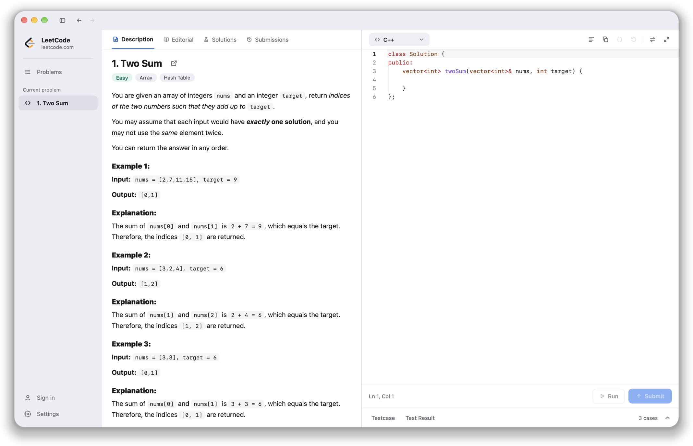
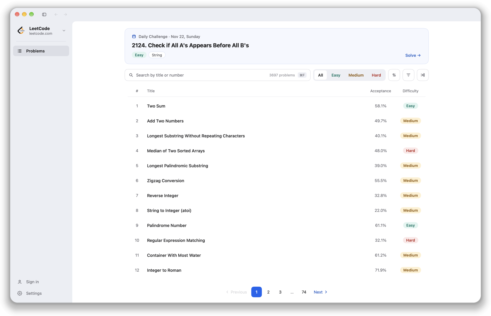

<div align="center">


# Declic

**A fast, native, open-source desktop client for LeetCode. Practice until it clicks.**

Built with Go and [MyGo](https://github.com/egoist/mygo) Native UI for a focused desktop practice experience on both `leetcode.com` and `leetcode.cn`.

[](https://github.com/haeward/declic/releases)
[](https://github.com/haeward/declic/actions/workflows/ci.yml)
[](https://github.com/haeward/declic/releases)
[](go.mod)
[](LICENSE)

[Features](#features) · [Installation](#installation) · [Shortcuts](#keyboard-shortcuts) · [Roadmap](#roadmap) · [Privacy & Security](#privacy--security) · [Developing](#developing)

</div>

> [!IMPORTANT]
> Declic is an early preview release (`v0.1.x`), currently verified primarily on macOS 14+. Please use it with care and report bugs or share feedback through [GitHub Issues](https://github.com/haeward/declic/issues).

<div align="center">
  <picture>
    <source media="(prefers-color-scheme: dark)" srcset="screenshots/workspace-dark.png" />
    <source media="(prefers-color-scheme: light)" srcset="screenshots/workspace-light.png" />
    
  </picture>
  <sub><b>Workspace</b> — Sanitized statement, native code editor, and inline Online Judge</sub>
</div>

## Features

- **Problem library & Daily Challenge**: Full per-site public catalog indexing with 24-hour local caching, instant search, difficulty/topic/access/solved filters, sorting, pagination, Pick One, keyboard navigation (`↑` / `↓` / `Enter`), Quick Open (`⌘P` / `⌘K`), and a site-aware Daily Challenge card.
- **Dual-site isolation**: Switch between `leetcode.com` and `leetcode.cn` with completely separate browser sessions, accounts, solved status, caches, and local drafts.
- **Rich native Workspace**:
  - **Description**: Sanitized HTML rendered in an isolated ephemeral WebView with native MathML typesetting, CN bilingual toggle (`中文 / EN`), collapsible table of contents, separate Hints, and clickable Similar Questions.
  - **Editorial & Solutions**: Native Markdown reader with inline and display TeX math, Mermaid diagrams, interactive walkthrough slides, embedded LeetCode Playground multi-language code tabs, and isolated inline video solution players.
  - **Submissions**: Signed-in submission history with status/language filters, syntax-highlighted code inspection, and one-click `Use this code`.
- **Native code editor & local drafts**: Supports 25 LeetCode languages with syntax highlighting, zero-dependency code formatting, template reset, quick editor settings, Focus Editor mode (`⌘\`), and automatic versioned local draft saving separated by site, account, problem, and language.
- **Online Judge**: Editable testcases, `Run` (`⌘↩`) with Output vs. Expected character-level diff, and `Submit` (`⌘⇧↩`) with verdict, runtime/memory metrics, and percentile beats.
- **Customizable desktop experience**: System, Light, and Dark appearances synced with native window chrome, contrast & density controls, description/editor typography settings, macOS alternate Dock icons, startup continuity, and storage management.

<div align="center">
  <picture>
    <source media="(prefers-color-scheme: dark)" srcset="screenshots/problems-dark.png" />
    <source media="(prefers-color-scheme: light)" srcset="screenshots/problems-light.png" />
    
  </picture>
  <sub><b>Problem Library</b> — Daily Challenge, instant local search, multi-facet filters, and pagination</sub>
</div>

## Installation

### macOS (14.0+)

Download the latest `.dmg` from [GitHub Releases](https://github.com/haeward/declic/releases):

- **Apple Silicon** (M1 / M2 / M3 / M4): `declic-<version>-arm64.dmg`
- **Intel Mac** (`x86_64`): `declic-<version>-amd64.dmg`

Open the disk image and drag **Declic** into `/Applications`.

<details>
<summary>First-launch Gatekeeper note (ad-hoc signed preview)</summary>

Early preview builds are ad-hoc signed and **not notarized** with an Apple Developer ID certificate. If macOS reports that Declic cannot be verified or appears damaged when opening it for the first time, clear the quarantine attribute once in Terminal:

```sh
xattr -dr com.apple.quarantine /Applications/Declic.app
```

You can also verify the download against the `SHA256SUMS.txt` file attached to each release:

```sh
shasum -a 256 -c SHA256SUMS.txt
```

</details>

> Windows and Linux prebuilt packages are planned after native runtime validation. In the meantime, you can run from source using the steps under [Developing](#developing).

## Keyboard Shortcuts

<details>
<summary>View built-in shortcuts (macOS / Windows & Linux)</summary>

| Action | macOS | Windows / Linux |
| --- | --- | --- |
| Quick open problem | `⌘ P` / `⌘ K` | `Ctrl P` / `Ctrl K` |
| Search catalog / Find in editor | `⌘ F` | `Ctrl F` |
| Run testcases | `⌘ ↩` | `Ctrl ↩` |
| Submit solution | `⌘ ⇧ ↩` | `Ctrl Shift ↩` |
| Toggle test panel | `⌘ J` | `Ctrl J` |
| Focus editor (maximize/restore) | `⌘ \` | `Ctrl \` |
| Toggle sidebar | `⌘ B` | `Ctrl B` |
| Navigate back / forward | `⌘ [` / `⌘ ]` | `Alt ←` / `Alt →` |
| Save local draft | `⌘ S` | `Ctrl S` |
| Open Settings | `⌘ ,` | `Ctrl ,` |

</details>

## Roadmap

- [ ] **Deeper editor & judge loop**: Compile/runtime error diagnostics with click-to-jump, language draft indicators, basic code completion, side-by-side diff against past submissions, and customizable shortcuts.
- [ ] **Cross-platform & signed releases**: Native runtime validation and installers for Windows and Linux, signed/notarized release packages, and optional in-app updates.
- [ ] **Catalog expansion & localization**: Additional LeetCode categories (Database, Shell, Concurrency, JavaScript), curated study plans, and Simplified Chinese UI localization.
- [ ] **Focused practice modes**: Vim keymap mode, reusable algorithm snippets, and a distraction-free mock interview mode.

## Privacy & Security

- **Official sign-in only**: Authentication happens on the official `leetcode.com` or `leetcode.cn` page inside an isolated WebView. Declic never sees or stores your password.
- **Strict isolation**: `leetcode.com` and `leetcode.cn` sessions, accounts, public caches, and drafts are completely separated. Untrusted HTML descriptions and inline video players run in ephemeral sessions without login cookies.
- **Local-first drafts, zero telemetry**: Code drafts stay on your machine as plain source files; Premium content, credentials, and private submissions are never written to public disk caches. Declic makes no telemetry requests.

See [SECURITY.md](SECURITY.md) for full details and vulnerability reporting instructions.

## Developing

Use the Go and MyGo versions pinned in [go.mod](go.mod). From the repository root, check prerequisites and launch the development app:

```sh
go tool mygo doctor
go tool mygo dev
```

Run offline verification checks:

```sh
go test -race ./...
go vet ./...
go tool mygo vet .
```

Build production packages locally (macOS):

```sh
go tool mygo build -platform darwin/arm64,darwin/amd64
```

## Acknowledgements

- [MyGo](https://github.com/egoist/mygo) — native desktop UI framework, code editor (`ui/editor`), Markdown renderer (`ui/markdown`), WebViews, and packaging toolchain.
- [Leetgo](https://github.com/j178/leetgo) — implementation reference for `leetcode.com` and `leetcode.cn` API integration.
- Go supplementary packages [`golang.org/x/net`](https://pkg.go.dev/golang.org/x/net/html) (HTML parsing and sanitization) and [`golang.org/x/image`](https://pkg.go.dev/golang.org/x/image/webp) (WebP decoding).

*Declic is an independent, unofficial client and is not affiliated with or endorsed by LeetCode.*

## Contributing

Contributions are welcome. See [CONTRIBUTING.md](CONTRIBUTING.md) for setup, pull request guidelines, and verification checks.

## License

Declic is licensed under the [MIT License](LICENSE).
