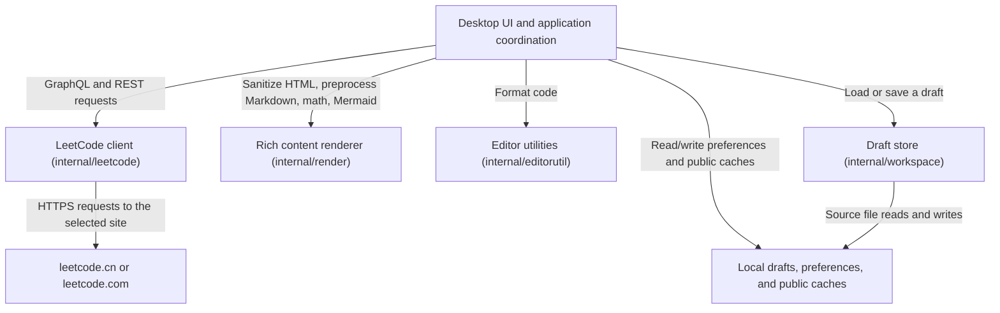
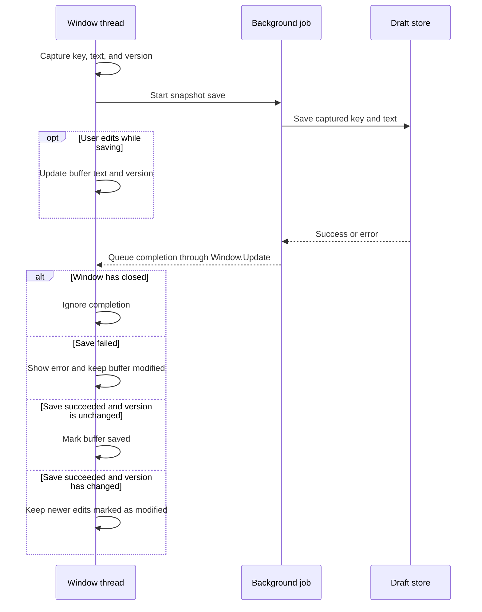

# Architecture

Declic is a Go desktop application built with MyGo Native UI (`ui`, `ui/editor`, and `ui/markdown`). The application coordinates user actions, LeetCode requests, browser sessions, rich content rendering, public metadata caches, and local drafts. This document defines their responsibilities, data ownership, and consistency rules.

## Overview

The following diagram shows the core application, rendering, API, cache, and draft paths. Arrows indicate calls or I/O initiated by the source component; responses return to the caller. Browser and WebView isolation boundaries are described under [Trust Boundaries](#trust-boundaries).



## Core Decisions

- **Go and MyGo Native UI.** Application controls, code editing, and Editorial/Solutions reading use MyGo's native UI, editor, and Markdown components. WebViews handle official website login, sanitized HTML statements, and inline video players in separate sessions, keeping untrusted browser content isolated from login cookies and the native editor.
- **Explicit module boundaries.** The desktop package coordinates API, storage, cache, and rendering operations. `internal/leetcode`, `internal/workspace`, and `internal/editorutil` are pure Go standard-library packages with no UI or cross-package dependencies. `internal/render` handles HTML sanitization, Markdown preprocessing, and native TeX math / Mermaid rendering using `golang.org/x/net/html`, `internal/leetcode` (`Site`), and `mygo/ui` primitives, without depending on desktop application state or storage.
- **Site-scoped identity.** CN and COM have separate browser sessions, public caches, and local draft namespaces. A matching username or problem identifier does not join data across sites.
- **Source files for drafts.** Drafts remain directly inspectable as ordinary files. Persistence uses one file per draft key; the store does not provide a transaction spanning multiple drafts or browser-session changes.
- **Serialized application jobs and versioned saves.** One document-transition job is admitted at a time to prevent overlapping state changes. A save uses a captured text snapshot, allowing editing to continue without letting an older save mark newer edits as saved. Independent background tasks (catalog indexing, prefetching, remote media loading, and online judge polling) carry cancellation and generation/identity guards so stale results are ignored.

## Components and Dependencies

UI rendering and application coordination share the desktop package. They are distinct responsibilities within that package, not separate services.

| Component | Source | Responsibility |
| --- | --- | --- |
| Desktop application | [cmd/desktop/main.go](../cmd/desktop/main.go) | Owns UI state, coordinates serialized jobs and background tasks, selects documents, and handles save and close actions |
| Native views and assets | [cmd/desktop/view.go](../cmd/desktop/view.go) | Coordinates window chrome, navigation history, shortcuts, and active screen switching; views live in `shell.go`, `library.go`, `catalog_filter.go`, `workspace_view.go`, `resources.go`, `judge.go`, `login.go`, and `settings_view.go`; window sizing/centering, reusable components, icons, theme, macOS Dock icon support, and embedded assets live in `window.go`, `components.go`, `icons.go`, `theme.go`, `dock_icon*.go`, and `assets/` |
| Session access | [cmd/desktop/session.go](../cmd/desktop/session.go) | Reads permitted cookies (`LEETCODE_SESSION`, `csrftoken`, `cf_clearance`) from the selected site's MyGo session with an 8-second timeout, verifies session identity with a 5-minute in-memory cache, and loads viewer profile/solved state |
| Rich content rendering | [internal/render/](../internal/render) | Sanitizes untrusted statement HTML (`html.go`), preprocesses Editorial/Solutions Markdown (`markdown.go`), and renders native TeX math (`math.go`) and Mermaid diagrams (`mermaid.go`); app-level statement/card/slides/video adapters live in `cmd/desktop/description.go`, `markdown_cards.go`, `slides_view.go`, and `video_player.go` |
| Editor utilities | [internal/editorutil/format.go](../internal/editorutil/format.go) | Standalone zero-dependency code formatting (`go/format` for Go, brace/whitespace formatting for other languages) decoupled from desktop UI state |
| Local preferences, storage, and caches | [cmd/desktop/preferences.go](../cmd/desktop/preferences.go) | Persists UI preferences (`ui-preferences.json`); storage usage stats and cache clearing live in `storage.go`; public per-site catalog, problem detail, and editorial caches plus safe remote bitmap fetching live in `catalog_cache.go` and `detail_cache.go` |
| LeetCode client | [internal/leetcode/client.go](../internal/leetcode/client.go) | Constructs requests, handles HTTP/GraphQL responses and rate limits, and maps site-specific fields to Go values (`judge.go`, `resources.go`, `status.go`) |
| Draft store | [internal/workspace/store.go](../internal/workspace/store.go) | Validates draft keys, resolves file paths across supported language extensions, and loads or saves source text |

The API client returns data without selecting editor documents. The store accepts a draft key and text without reading UI state or obtaining credentials. The desktop application decides when either result changes the active document. Protocol details belong in [API.md](API.md).

## State and Data Model

The desktop application owns the selected site, account namespace, problem, language, editor buffer, and operation status. These values are updated on the window thread. Background jobs and async tasks perform I/O and return completion callbacks through `Window.Update`; they do not directly mutate UI state or replace editor contents off-thread.

The job gate (`busy`) disables or rejects actions that would start another document job while one is pending. The editor is read-only during jobs except for snapshot-only saves (`saving`), and is also read-only when no problem is selected. Independent background tasks — catalog indexing (`catalogCancel` / `catalogGeneration`), Daily Challenge refresh, public detail/editorial prefetching, remote image/slide fetches, and online judge polling (`judgeState`) — run outside the document job gate and guard completions against window closure, site/account/problem changes, or generation mismatch.

A draft is identified by four fields:

| Key field | Value | Meaning |
| --- | --- | --- |
| Site | `leetcode-cn` or `leetcode-com` | Local namespace for the selected LeetCode site |
| Account | `anonymous` or the lowercase hexadecimal SHA-256 of a verified username | Separates guest and account drafts within that site |
| Problem | `questionId` | Internal problem identifier within the selected site |
| Language | `langSlug` | Language identifier returned with a code template |

On-disk storage under `<MyGo user-data directory>` is organized as:

```text
<user-data>/
├── ui-preferences.json
├── Workspace/
│   └── <site>/<account>/<questionId>/<langSlug>/solution.<extension>
└── cache/
    ├── catalog/<leetcode.com|leetcode.cn>.json        (24h public catalog index cache; read-only fallback to legacy Workspace/cache/)
    └── <leetcode-com|leetcode-cn>/
        ├── problems/<slug>.json                       (7-day non-paid problem detail cache)
        └── editorials/<slug>.json                     (7-day public editorial cache)
```

The draft store validates each path component and maps 25 supported language identifiers to file extensions. Display numbers and URL slugs are not draft identifiers. The account hash names a directory; it does not encrypt its contents.

UI preferences (site, appearance, macOS Dock icon, contrast, typography, density, column visibility, editor settings, and layout splits) are written atomically to `ui-preferences.json` via debounced background persistence during the session and flushed on normal shutdown (skipped if the existing preferences file failed to parse, to avoid overwriting user data). Public metadata caches are replaceable and never persist Premium content, credentials, or private submissions. In-memory caches are bounded (`detailCache` at 64 problems, `resourceCache` at 24 problem buckets, `imageCache` at 128 bitmaps); paid problem details are purged from memory on sign-out, session expiry, or site switch.

Browser authentication and local account selection are separate operations. Explicit or login-window session verification must return both a signed-in result and a nonempty username before account drafts are selected. Guest and account drafts remain in their own namespaces; selecting an account does not merge them.

## Key Flows

### Loading and switching documents

Startup reads `ui-preferences.json` (defaulting to `leetcode.com`), syncs the native window appearance (`syncNativeTheme`), restores the macOS Dock icon preference (`restoreDockIcon`), and loads the public catalog and Daily Challenge with an empty editor. When `Restore session on launch` is enabled (default), Declic checks off-thread whether the selected site's named session already holds a `LEETCODE_SESSION` cookie (making no network request for guests), verifies it via `userStatus`, and commits the verified account namespace if the user has not switched sites or signed in manually; when `Open on launch` is set to `Last workspace`, it then opens the last problem slug for that site (skipping unentitled Premium problems silently). Problems and Workspace share the global navigation sidebar (with back/forward history and up to 5 recent problems); returning to Problems retains the current catalog search, page, and scroll position. Switching sites first saves pending edits, then clears the selected problem, selects that site's guest namespace, and loads its catalog without auto-restoring the other site's session. No draft file is created until a problem is selected and edited. Session verification can select an account namespace while the editor is empty, without reading a draft.

Opening a problem or changing the language or account of an open problem follows these steps:

1. Save pending edits before a user-requested document or account transition. A failed save stops that transition.
2. Resolve the destination key and code template. Opening a remote problem checks the in-memory cache, public disk cache (for non-paid problems), and otherwise enters Workspace immediately with catalog metadata while loading detail off-thread through the API client (verifying viewer Premium entitlement before authenticated detail requests for paid problems).
3. Read the destination draft. Use the template only if the file does not exist; an existing empty file is a valid draft. Other read errors leave the active document unchanged.
4. After a successful read, update the selected site, account, problem, and language together with the editor buffer. Reset the buffer so the previous document's undo history is not carried into the new document.

This ordering protects the association between the displayed text and its save destination. It does not make changes to browser-session storage part of the same operation.

### Saving a snapshot

The diagram covers an automatic or manual snapshot save when the window is open, the buffer is modified, and no other application job is pending. The draft store runs within the background job; its separate lifeline identifies responsibility, not another thread or process. The optional edit illustrates work that can happen while the save is in progress.



The store writes a temporary file in the destination directory, syncs and closes it, then renames it over the destination. Write failures are returned to the application. This sequence does not establish a cross-platform guarantee of atomic replacement or recovery after power loss.

A save that precedes a document transition disables editing and invokes the next action only after success. For user-initiated, cancelable closes and quits, window-close and application-quit handlers prevent exit while a job is pending or the buffer is modified; when idle with unsaved edits, they save before retrying the close or quit action, and a save failure keeps the window open with the text available for retry. When the operating system forces session termination on macOS or Windows (`QuitEvent.SessionEnding`), cancellation is ignored by the OS, so the quit handler waits briefly for any in-flight save to finish on disk and synchronously performs a best-effort flush of newer draft edits and pending UI preferences. Draft persistence uses `editor.Buffer.Snapshot().WriteTo` to preserve existing per-line endings.

### Running and submitting code

Run (`interpret_solution`) and Submit (`submit`) require a signed-in viewer and operate on a captured snapshot of the selected site, problem, language, editor text, and (for Run) active testcases:

1. Verify session cookies for the active username (reusing the 5-minute in-memory verification cache when fresh; invalidating on 401/403 or expiry).
2. Send a single Run or Submit request to the selected site. Submissions never retry automatically and enforce a 15-second cooldown after dispatch.
3. Poll `/submissions/detail/<id>/check/` every 1.5 seconds (up to a 60-second timeout) until `SUCCESS`, a terminal error, or local cancellation (`Stop waiting`, problem/site/account change, or window close).
4. On an `Accepted` submission, invalidate cached Submissions for the problem and mark the problem solved in memory.

## Trust Boundaries

Login, description, and inline video WebViews have separate purposes and session storage:

| WebView | Session | Content boundary |
| --- | --- | --- |
| Login window | Named session for the selected site | Starts at the official login page, permits HTTPS navigation, and uses MyGo's untrusted-page setting |
| Description preview | Separate ephemeral session | Receives sanitized HTML and uses the untrusted-page setting; its content policy permits HTTPS images while blocking scripts, frames, and fetch connections; intercepts `https://declic.local/problem/<slug>` (opens in Workspace) and `https://declic.local/video` (opens problem externally), permits `about:blank#` TOC anchors, and blocks other navigations |
| Inline video player | Shared ephemeral session (separate from login) | Renders allowlisted HTTPS video providers or direct HTTPS video streams (`.mp4`, `.webm`, `.mov`, `.m4v`) inside Editorial/Solutions with `Untrusted: true` and HTTPS-only navigation; destroyed on tab, problem, site, or window changes |

Neither the description preview nor the inline video player shares login cookies or receives privileged application bindings. Editorial and Solutions articles render natively in MyGo UI (Markdown, TeX math, Mermaid diagrams, and slide decks). Remote image, avatar, and slide fetches use HTTPS-only, cookie-free HTTP clients with bounded timeouts and response sizes; requests may reach hosts outside LeetCode without account cookies.

Language support is shared with the draft store extension allowlist. Existing Java, Rust, and Python draft paths are unchanged; additional supported templates use their own language directories.

The application reads selected cookies from a site's login session only for account requests. Guest list, daily challenge, detail, article, and Playground requests receive no cookies. The Go API client sends requests to the selected HTTPS origin and refuses redirects. Browser-session storage remains separate from draft files.

Credential protection, external-content restrictions, and data-protection requirements are defined in [SECURITY.md](../SECURITY.md).
